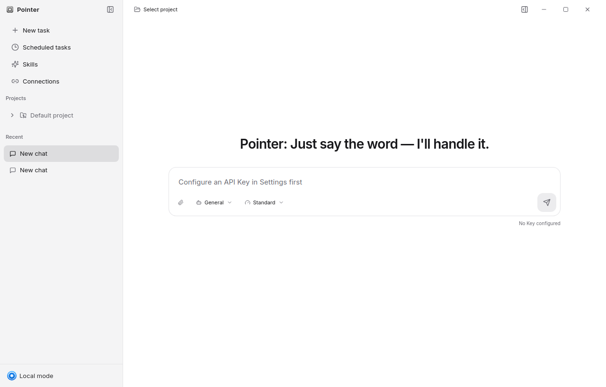
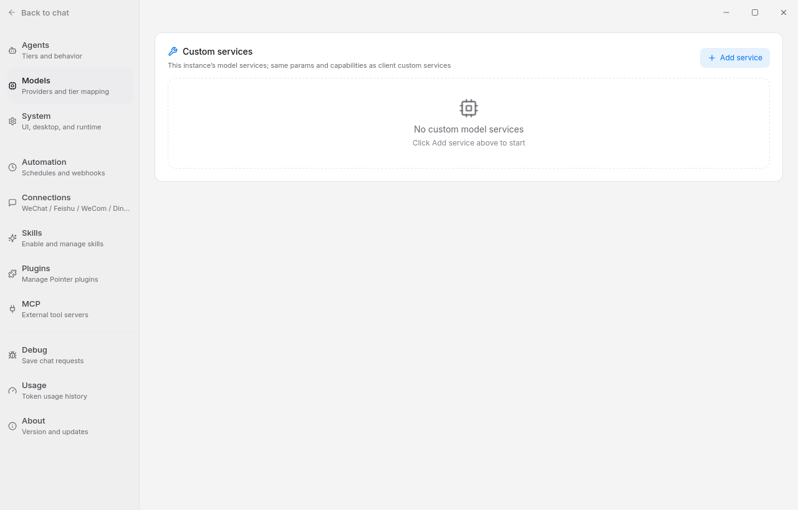
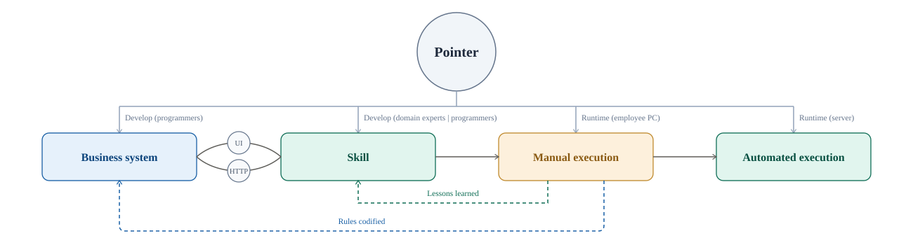
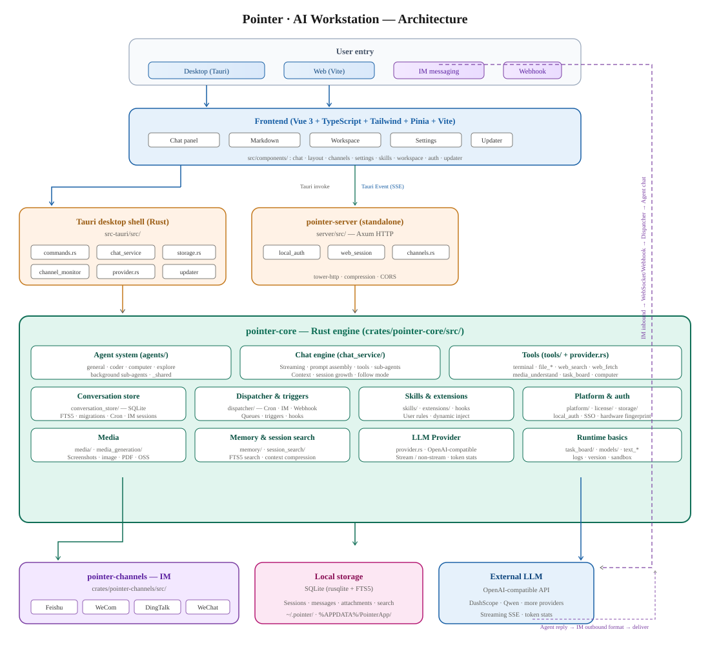

# Pointer

**An out-of-the-box, ultra-low-resource desktop agent foundation for building digital employees. Built for developers and the enterprise.**

Build and run digital employees on the computer people already use, and keep them running stably on a server. Both the agent and the model can stay inside your own environment, with no per-seat fees. The desktop app and the web app share the same capabilities, on Windows, macOS, and Linux.

| You want | Get it here |
| --- | --- |
| Ready to use, out of the box | [Official download](https://pointer.readflowai.com/download) |
| Community installers | [GitHub Releases](https://github.com/chinphing/agent-pointer/releases) |
| Deploy inside your company | [Deployment guide](docs/en/deploy/README.md) |

[简体中文](README.zh-CN.md)

[](LICENSE)

## Why Pointer

A digital employee has to work inside a real office setup: a license that allows commercial use, a desktop client and a web app, a small footprint, eyes and a mouse on the screen, and one conversation that can keep going.

<table>
  <thead>
    <tr>
      <th></th>
      <th>Typical agents</th>
      <th>Pointer</th>
    </tr>
  </thead>
  <tbody>
    <tr>
      <td>Enterprise Feature</td>
      <td>Open-source agents are mostly a CLI, priced per seat, and each person keeps their own skills</td>
      <td><strong><a href="LICENSE">Apache 2.0</a></strong>, free to use and free to customize. <strong>A desktop client and a web app, with the same capabilities.</strong> Skills are managed and developed in one place</td>
    </tr>
    <tr>
      <td rowspan="3">Resource use</td>
      <td>About 300 MB installer download</td>
      <td><strong>About 25 MB</strong></td>
    </tr>
    <tr>
      <td>1 GB+ resident memory</td>
      <td><strong>About 300 MB</strong></td>
    </tr>
    <tr>
      <td>One task can take 100%+ CPU. Extra tasks crowd out other work</td>
      <td><strong>About 5% of one CPU core</strong> while running. <strong>20+ sub-agents at once</strong>. Other tasks are completely unaffected</td>
    </tr>
    <tr>
      <td>Computer Use for any software you can see</td>
      <td>Depends on a browser debug protocol or the OS accessibility tree</td>
      <td><strong>Screenshots and the mouse only.</strong> No CDP, and no accessibility tree. <strong>Qwen3.8-flash is enough.</strong> The same task costs about <strong>1/20</strong> of Codex</td>
    </tr>
    <tr>
      <td>Long conversations</td>
      <td>When the context fills up, you start a new chat, and earlier work is easy to lose</td>
      <td><strong>Stay in one conversation for as long as you want.</strong> It pages automatically, compresses context automatically, and you can mark milestones for quick recall</td>
    </tr>
  </tbody>
</table>

<p class="why-pointer-shots">
  
  
</p>

## What Pointer does

Pointer is more than a runtime for Skills. It builds the business system, helps turn manual work into a Skill that drives it through its UI and HTTP interfaces, and carries what manual runs teach back into the Skill and the system itself.



### General agent capabilities

| Capability | What you get |
| --- | --- |
| Agent system | Built-in general, coder, computer, and explore. [Sub-agents](docs/en/user/subagents.md) can run in the background so the main conversation can continue |
| Chat engine | Streaming, prompt assembly, and tool calling; long conversations, context compression, and milestone recall |
| Tools | Terminal, file read/write/search, web search and fetch, task board; vision computer control for GUI apps (still being improved) |
| Skills and extensions | [Skills](docs/en/user/skills.md), [plugins](docs/en/user/plugins.md), and user rules; external tools via [MCP](docs/en/user/mcp.md) |
| Dispatch and triggers | Scheduled tasks, [webhooks](docs/zh-CN/user/webhook.md), and IM inbound events enter chat through one dispatcher |
| Entry points | Desktop, web, and [Feishu, DingTalk, WeCom, and WeChat](docs/en/user/im-channels.md) |
| Model access | OpenAI-compatible APIs. Qwen and DeepSeek are built in; Doubao, Kimi, Zhipu, OpenRouter, and others can be added—no single-vendor lock-in |

### What was added for Skill development and testing

After a role is written as a reusable Skill, you need a shared format, an easy install path, editing in the conversation, and a way to validate it at scale.

| What you need | What Pointer provides |
| --- | --- |
| Write in a shared format | [Skills](docs/en/user/skills.md) use a common skill format, compatible with Codex and similar directories. Instructions, references, scripts, and assets stay separate |
| Install, then turn it on | Enable skills in the library, including zip import. Existing skills can be imported from Codex, Claude, OpenClaw, and Hermes |
| Author and edit in the conversation | Creating, editing, reviewing, and packaging goes to the coding sub-agent. A skill can also ship inside a [plugin](docs/en/user/plugins.md) |
| Skill validation | Run the Skill under high-concurrency background sub-agents in isolated environments, and sweep many test samples quickly to check stability and correctness |
| Fill in a missing runtime | If Node, Python, or another runtime is missing, install it in the conversation and keep testing the skill |

Start with [getting started](docs/en/user/getting-started.md).

## Roadmap

1. Keep improving Skill and plugin development.
2. Support Skill authorization across multiple accounts.
3. Add sandbox-based, server-side per-user isolation.
4. More to come.

## Architecture

The desktop app, web app, and IM channels share one `pointer-core`. The UI handles interaction; orchestration, tools, Skills, and sessions live in the core.



Layer notes: [docs/en/developer/architecture.md](docs/en/developer/architecture.md).

## Documentation

| Audience | Start here |
| --- | --- |
| Users | [docs/user/](docs/en/user/README.md) |
| Developers | [docs/developer/](docs/en/developer/README.md) |
| Contributors | [CONTRIBUTING.md](CONTRIBUTING.md) · [docs/en/DEVELOPMENT.md](docs/en/DEVELOPMENT.md) |
| Security | [SECURITY.md](SECURITY.md) |
| Changes | [CHANGELOG.md](CHANGELOG.md) |

Full index: [docs/README.md](docs/README.md).

## Develop

The desktop app is Tauri 2 and Vue 3. The web UI is the same interface served by `pointer-server`. Chat, tools, Skills, and agents live in `crates/pointer-core`.

### Client

```bash
npm install
npm run tauri:dev
```

The desktop window opens with no control plane bound when `pointer.local.env` is absent. The first compile can take a few minutes.

### Web Server

Use two terminals:

```bash
# terminal 1
npm install
npm run server:dev

# terminal 2
npm run web:dev
```

Then open `http://127.0.0.1:1420/`. Details: [docs/en/DEVELOPMENT.md](docs/en/DEVELOPMENT.md).

## Deploy

Users start the desktop client with the script. It does not call npm. An existing `target/release/pointer-app` or an installed app opens directly; `--build` is what recompiles locally:

```bash
./scripts/quick-deploy.sh start standalone-client --runtime bin
```

Flavour (`POINTER_EDITION`) and runtime form (client / server) matter when you are building an installer:

| What you are doing | Start here |
| --- | --- |
| Run a client locally, or hand a self-built client to colleagues | [standalone × client](docs/en/deploy/README.md#standalone-client) |
| Stand up a server for your team | [standalone × server](docs/en/deploy/README.md#standalone-server) |
| Enterprise: client bound to your internal control plane | [managed × client](docs/en/deploy/README.md#managed-client) |
| Enterprise: deploy the control-plane server | [managed × server](docs/en/deploy/README.md#managed-server) |

All four — build command, variables, artifacts, verification, dependencies: [docs/en/deploy/README.md](docs/en/deploy/README.md).
Platform packaging (Windows / macOS / Linux): [docs/en/deploy/platforms.md](docs/en/deploy/platforms.md).

## Release

Bump the root `VERSION` file, sync, then push a `v*.*.*` tag. CI builds Windows / macOS / Linux and opens a draft on [GitHub Releases](https://github.com/chinphing/agent-pointer/releases). **CI produces the standalone client package only** — managed (official / enterprise) packages are built locally or on your own CI.

```bash
# edit VERSION, then:
npm run version:sync
npm run version:check

git tag v0.1.2
git push origin v0.1.2

# or build packages on this machine:
npm run tauri:build
npm run server:build
```

Details: [docs/en/contributing/cross-platform-build.md](docs/en/contributing/cross-platform-build.md) · [docs/en/contributing/versioning.md](docs/en/contributing/versioning.md).

## Acknowledgments

Pointer learned from and was inspired by:

- [OpenClaw](https://github.com/openclaw/openclaw) by Peter Steinberger and the [OpenClaw Foundation](https://openclaw.org)
- [Hermes Agent](https://github.com/NousResearch/hermes-agent) by Nous Research

## License

Apache License 2.0. Copyright 2026 刘新星 (https://pointer.readflowai.com). Trademarks and official domains are described in [NOTICE](NOTICE).
