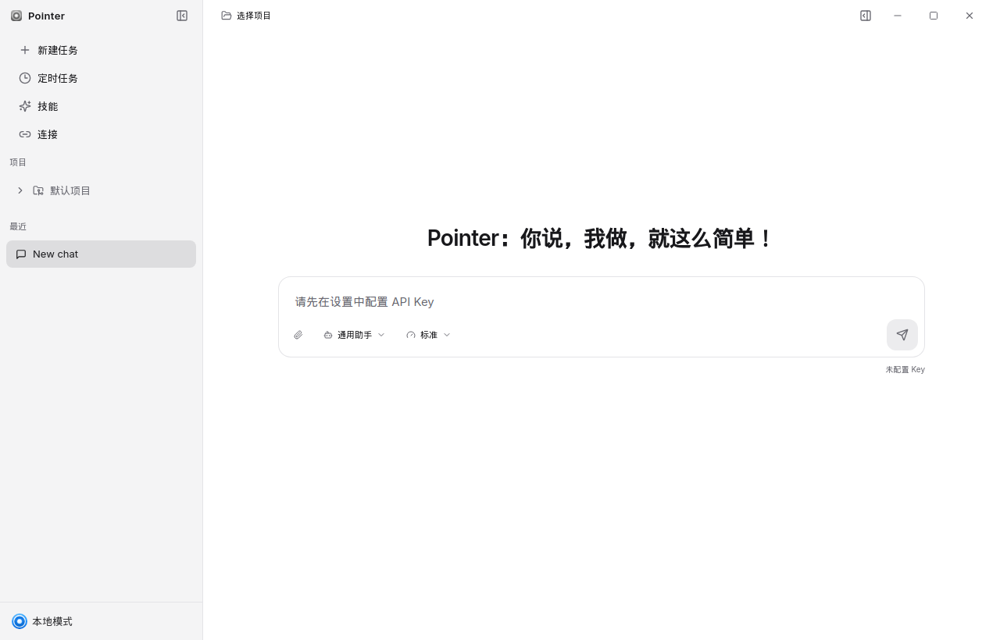
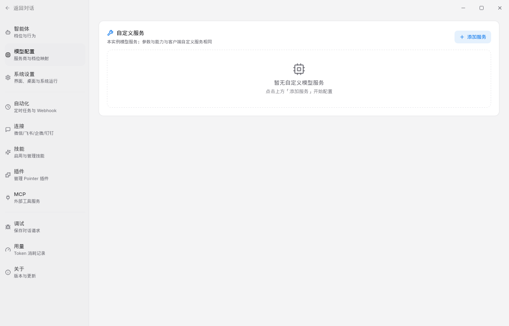
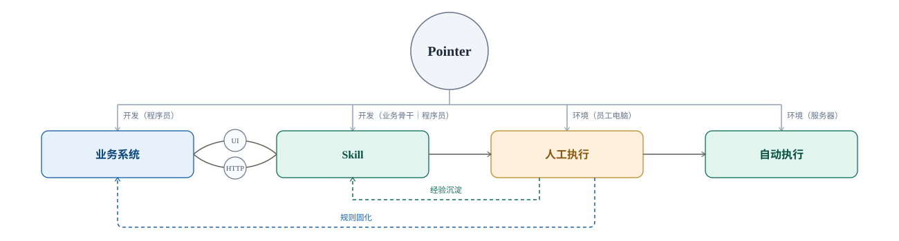
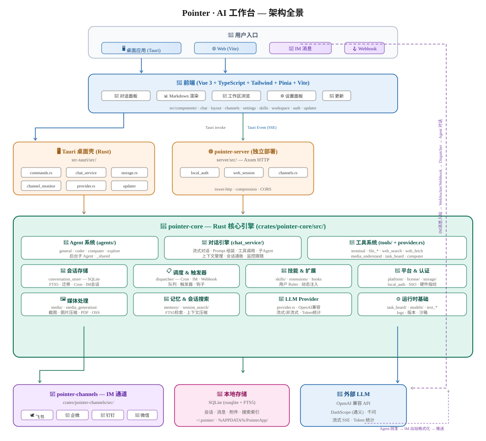

# Pointer

**开箱即用、超级低资源消耗的桌面智能体基座，用来打造数字员工。面向开发者和企业。**

把数字员工做出来，跑在员工日常用的电脑上，也能在服务器上长期跑。智能体和模型都可以留在你自己的环境里，也不按坐席收费。桌面端和 Web 端能力一致，支持 Windows、macOS、Linux。

| 你想要 | 怎么拿 |
| --- | --- |
| 装上就能用 | [官网下载](https://pointer.readflowai.com/download) |
| 社区版安装包 | [GitHub Releases](https://github.com/chinphing/agent-pointer/releases) |
| 放进公司自己的环境 | [部署指南](docs/zh-CN/deploy/README.md) |

[English](README.md)

[](LICENSE)

## 为什么选择 Pointer

数字员工要在真实办公环境里干活：协议能商用，桌面客户端和 Web 同一套能力，资源占用低，只靠截图和鼠标就能操作屏幕，一场对话也可以一直接着聊。

<table>
  <thead>
    <tr>
      <th></th>
      <th>常见智能体</th>
      <th>Pointer</th>
    </tr>
  </thead>
  <tbody>
    <tr>
      <td>企业特性</td>
      <td>开源多半是命令行，按席位收费，技能各管各的</td>
      <td><strong><a href="LICENSE">Apache 2.0</a></strong>，可商用、可自行修改。<strong>桌面客户端和 Web 同一套能力。</strong>技能统一管理和开发</td>
    </tr>
    <tr>
      <td rowspan="3">资源占用</td>
      <td>安装包下载约 300 MB</td>
      <td><strong>约 25 MB</strong></td>
    </tr>
    <tr>
      <td>常态内存 1 GB 以上</td>
      <td><strong>约 300 MB</strong></td>
    </tr>
    <tr>
      <td>一个任务就能把 CPU 打满。多开几个任务，本机其他工作就卡了</td>
      <td><strong>运行大约吃单核 5%</strong>。<strong>20 个以上子智能体同时跑也没问题</strong>，其他任务基本不受影响</td>
    </tr>
    <tr>
      <td>电脑操控<br>看得见的软件都能操作</td>
      <td>靠浏览器调试协议或系统无障碍树</td>
      <td><strong>只看截图、只操作鼠标。</strong>不依赖 CDP，也不依赖无障碍树。你能操作的软件，它也能。<strong>Qwen3.8-flash 即可用</strong>，同样的任务，成本大约是 Codex 的 <strong>1/20</strong></td>
    </tr>
    <tr>
      <td>超长会话</td>
      <td>上下文一满就得新开，以前聊过的容易丢</td>
      <td><strong>想一直聊就一直聊。</strong>自动分页、自动压缩上下文，重要节点可标里程碑，随时跳回去</td>
    </tr>
  </tbody>
</table>

<p class="why-pointer-shots">
  
  
</p>

## Pointer 能做什么

Pointer 不只是一个跑 Skill 的运行时。它开发业务系统，把人工流程做成 Skill（经 UI 与 HTTP 接口驱动业务系统），再把人工执行沉淀的经验和确定性规则，分别回写到 Skill 和业务系统本身。



### 通用 Agent 能力

| 能力 | 说明 |
| --- | --- |
| Agent 系统 | 内置 general、coder、computer、explore。[子智能体](docs/zh-CN/user/subagents.md) 可后台并行，主对话不用停 |
| 对话引擎 | 流式输出、Prompt 组装、工具调用；支持超长会话、上下文压缩、里程碑召回 |
| 工具执行 | 终端、文件读写检索、联网搜索与抓取、任务板；电脑侧靠纯视觉操控有界面的软件（还在打磨） |
| 技能与扩展 | [Skills](docs/zh-CN/user/skills.md)、[插件](docs/zh-CN/user/plugins.md)、用户 Rules；外部工具接 [MCP](docs/zh-CN/user/mcp.md) |
| 调度与触发 | 定时任务、[Webhook](docs/zh-CN/user/webhook.md)、IM 入站，经统一调度进对话 |
| 多入口 | 桌面端、Web 端，以及[飞书、钉钉、企业微信、微信](docs/zh-CN/user/im-channels.md) |
| 模型接入 | OpenAI 兼容接口。内置千问、深度求索，也可接豆包、Kimi、智谱、OpenRouter 等，不绑死一家 |

### 为 Skill 开发与测试补上的能力

岗位流程写成可复用 Skill 之后，要写得顺、装得上、在对话里改得动，还能大批量验证稳不稳、对不对。

| 场景 | 怎么做 |
| --- | --- |
| 按通用格式来写 | [Skills](docs/zh-CN/user/skills.md) 用常见的技能说明格式，和 Codex 一类目录兼容。说明、参考资料、脚本、资源分开放 |
| 装进技能库再打开 | 技能库里勾选启用，也支持 zip 导入。本机已有的 Codex、Claude、OpenClaw、Hermes 技能可以一键迁过来 |
| 对着对话就能改 | 新建、修改、审查、打包交给写代码的子智能体。也可以打进[插件](docs/zh-CN/user/plugins.md)一起发 |
| Skill 验证 | 用高并发的后台子 Agent，在隔离环境里跑 Skill，快速过大量测试样本，看执行稳不稳、对不对 |
| 缺环境就补环境 | 缺 Node、Python 之类，对话里装好再继续测 |

想上手，看 [快速上手](docs/zh-CN/user/getting-started.md)。

## 路线图

1. 继续完善技能开发与插件开发功能。
2. 支持多账号下的技能授权。
3. 实现基于沙箱的服务端用户隔离。
4. 更多……

## 架构

桌面端、Web 端、IM 通道共用一套 `pointer-core`：界面只负责交互，编排、工具、Skills、会话都在核心层。



分层说明见 [docs/developer/architecture.md](docs/zh-CN/developer/architecture.md)。

## 文档

| 读者 | 入口 |
| --- | --- |
| 用户 | [docs/user/](docs/zh-CN/user/README.md) |
| 开发者 | [docs/developer/](docs/zh-CN/developer/README.md) |
| 贡献者 | [CONTRIBUTING.md](CONTRIBUTING.md) · [DEVELOPMENT.md](DEVELOPMENT.md) |
| 安全 | [SECURITY.md](SECURITY.md) |
| 变更 | [CHANGELOG.md](CHANGELOG.md) |

完整索引：[docs/README.md](docs/README.md)。

## 开发

桌面端是 Tauri 2 + Vue 3，Web 端由 `pointer-server` 提供同一套界面。对话、工具、Skills、Agent 都在 `crates/pointer-core`。

### 客户端

```bash
npm install
npm run tauri:dev
```

没有 `pointer.local.env` 时，桌面窗口会打开，并且不绑定控制面。第一次编译要几分钟。

### Web Server

开两个终端：

```bash
# 终端 1
npm install
npm run server:dev

# 终端 2
npm run web:dev
```

然后打开 `http://127.0.0.1:1420/`。细节见 [DEVELOPMENT.md](DEVELOPMENT.md)。

## 部署

用户用脚本直接启动桌面客户端。脚本不调用 npm。已有的 `target/release/pointer-app` 或已安装的程序直接打开；加上 `--build` 才在本地重新编译：

```bash
./scripts/quick-deploy.sh start standalone-client --runtime bin
```

要打安装包时，再按口味（`POINTER_EDITION`）和运行形态（客户端 / 服务端）选格子：

| 你要做的事 | 去哪 |
| --- | --- |
| 自己用，或给同事发**自己构建**的客户端 | [standalone × 客户端](docs/zh-CN/deploy/README.md#standalone-client) |
| 自己搭一台服务器给团队用 | [standalone × 服务端](docs/zh-CN/deploy/README.md#standalone-server) |
| 企业：客户端连**内网**控制面 | [managed × 客户端](docs/zh-CN/deploy/README.md#managed-client) |
| 企业：部署内网控制面服务端 | [managed × 服务端](docs/zh-CN/deploy/README.md#managed-server) |

四格完整清单（构建命令 / 变量 / 产物 / 验证 / 外部依赖）：[docs/zh-CN/deploy/README.md](docs/zh-CN/deploy/README.md)。
三平台打包：[docs/contributing/cross-platform-build.md](docs/zh-CN/contributing/cross-platform-build.md)。

## 发布

改根目录 `VERSION`，同步版本号，再推一个 `v*.*.*` 标签。CI 会打 Windows / macOS / Linux 包，并在 [GitHub Releases](https://github.com/chinphing/agent-pointer/releases) 生成草稿。**CI 只产 standalone 客户端包** —— managed（官方 / 企业）包在本地或企业 CI 打。

```bash
# 编辑 VERSION 后：
npm run version:sync
npm run version:check

git tag v0.1.2
git push origin v0.1.2

# 或在本机打安装包：
npm run tauri:build
npm run server:build
```

打包细节：[docs/contributing/cross-platform-build.md](docs/zh-CN/contributing/cross-platform-build.md)；版本号规则：[docs/contributing/versioning.md](docs/zh-CN/contributing/versioning.md)。

## 致谢

Pointer 的不少设计受到这些项目启发，在此致谢：

- [OpenClaw](https://github.com/openclaw/openclaw)（Peter Steinberger / [OpenClaw Foundation](https://openclaw.org)）
- [Hermes Agent](https://github.com/NousResearch/hermes-agent)（Nous Research）

## 许可证

Apache License 2.0。版权所有 © 2026 刘新星（https://pointer.readflowai.com）。商标与官方域名见 [NOTICE](NOTICE)。
