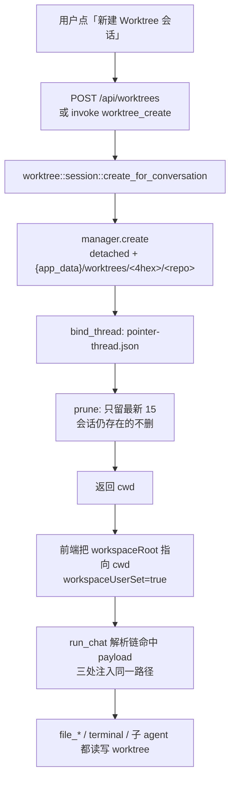

# 会话级 Git Worktree（实现记录与待办）

> **状态：P0 + P1 已落地**（2026-10-27，分支 `feat/session-worktree`，从 `main@628598b4` 切出）。
> P2 / P3 / P4 未做，清单见 [分期与待办](#六分期与待办)。
> 参考实现：OpenAI Codex `codex-rs/worktree`（`rust-v0.162.0`）。

## 一、要解决什么

Agent 直接改用户当前工作区，未提交的实验、进行中的功能分支、一次「顺手修测试」会叠在同一份 dirty tree 上；两个会话/子 agent 并行写同一仓库还会互相覆盖。

**worktree 只解决一件事：这次会话的读写落在哪一份检出。** 它不改变模型、不提供 OS 级隔离、不负责代码正确性。

## 二、机制速览

| 术语 | 业务中文 | 类比 |
|------|----------|------|
| `git worktree` | 同一仓库的第二份检出目录 | 一个档案柜（提交/分支库）配多张办公桌，每张桌有自己的文件 |
| 主检出 | 用户平时打开的那份 | 前台 |
| 受管 worktree | 本应用自动创建、记录归属、可列举可删除的那份 | 后台工位，带工牌 |
| detached HEAD | 不挂在任何分支上的检出点 | 临时工位，没登记在编制里 |

三条 git 硬约束（不是实现选择）：

1. **同一个分支同一时刻只能被一处 checkout** → 受管 worktree 一律 detached，要长期用就在 worktree 里 `git switch -c`。
2. **worktree 不复制未提交改动** → 主仓 dirty 文件不会出现在新树里。
3. **创建不改变当前进程 cwd** → 调用方必须显式使用返回的 `cwd`。

## 三、Codex 参考实现（结论摘要）

crate `codex-rs/worktree` 只有 5 个源文件（`lib` / `git` / `paths` / `settings` / `metadata`），约 30 KB。值得照抄的四点：

| 点 | Codex 做法 | 我们的取舍 |
|----|-----------|-----------|
| 创建 | `git worktree add --detach --no-checkout` → 写目标专属 `config.worktree` → `--work-tree=. reset --hard --no-recurse-submodules`；任一步失败 `worktree remove --force` 回滚 | 完全照抄 |
| 布局 | `<root>/<4 位随机 hex>/<仓库名>`，只认这个布局 | 完全照抄 |
| 列表过滤 | 布局 + `.git` 是文件 + common-dir 一致 + `.git` 回指校验，四重过滤，只认自己创建的 | 照抄前三重；回指校验留 P2（当前用 common-dir + 布局已足够排除手工 worktree） |
| git 调用硬化 | 清 `GIT_DIR`/`GIT_WORK_TREE`/… 16 个变量；禁 hooks / fsmonitor / attributes / clean-smudge-process filter；`GIT_LFS_SKIP_SMUDGE=1`；禁交互 | 完全照抄 |
| 归属 | worktree 自己的 git 目录里写 `codex-thread.json`，`persist_noclobber` 原子发布 | 改为 `pointer-thread.json`，同机制 |
| 清理 | `worktree-auto-cleanup-enabled` 默认开，`worktree-keep-count` 默认 15 | 同默认值；额外保护「会话仍存在」的 worktree |
| 模型工具 | `create_worktree` / `get_worktree_creation_status` / `list_worktrees`，异步 operationId | **不做**（见决策 5） |

## 四、决策记录（2026-10-27 与用户确认）

| # | 决策 | 取舍理由 |
|---|------|---------|
| 1 | **只做会话级**，不做「每个子 agent 一个 worktree」 | 子 agent 级需要槽位×磁盘预算，且 `run_subagent` 已有 `workspaceRoot` 可承接（P3） |
| 2 | **base = 当前 HEAD**（不是远端默认分支） | 用户日常在主检出上「接着干」，远端默认分支会把未推送的本地提交甩掉 |
| 3 | **落 `{app_data}/worktrees/`**，不落仓库同级 | 不污染仓库、跨项目统一、`git worktree list` 仍可见、整目录可清理 |
| 4 | **keep 15 自动清** | 社区实测：802 MB / 16000 文件的仓库每树约 810 MB，142 个残留占 97 GB |
| 5 | **不给模型 `create_worktree` 工具** | 模型自建树会让「会话工作区」变成可变字段，diff 基线 / PTY cwd 全部要跟着动；入口收在 UI |
| 6 | **不强隔离**（P4 单独立项） | 现状 `writable_path_roots` 含 home/temp，`terminal` 显式 `cwd` 不校验归属；收紧会改变现有 file/terminal 行为，属另一个产品决策 |

## 五、已落地（P0 + P1）

### 5.1 代码位置

| 层 | 文件 | 内容 |
|----|------|------|
| 核心 | `crates/pointer-core/src/worktree/mod.rs` | `WorktreeManager`：`create` / `list` / `remove` / `bind_thread` / `owner` / `prune` / `is_managed_path`；`inspect` / `inspect_with_root` |
| 核心 | `crates/pointer-core/src/worktree/git.rs` | 硬化 git 调用、`rev-parse` 封装、Windows verbatim 前缀剥离 |
| 核心 | `crates/pointer-core/src/worktree/paths.rs` | `{4hex}/{repo}` 桶分配、macOS `.metadata_never_index` |
| 核心 | `crates/pointer-core/src/worktree/metadata.rs` | `pointer-thread.json` 归属记录（原子发布、幂等） |
| 核心 | `crates/pointer-core/src/worktree/settings.rs` | 根目录 / 自动清理 / keep 数；`has_managed_layout` |
| 核心 | `crates/pointer-core/src/worktree/session.rs` | 会话级编排：create + bind + prune；`create_with_manager` 是测试用的可注入版本；`conversation_still_exists` 保护 |
| 核心 | `crates/pointer-core/src/workspace_resolve.rs` | `WorkspaceKind` 分类 + **唯一**的工具工作区兜底链（`registry` 与 `terminal` 改为调用它） |
| 核心 | `crates/pointer-core/src/conversation_store/mod.rs` | `conversation_exists(id)`（prune 用）；`delete_conversation` / `delete_project` 释放对应 worktree |
| 桌面 | `src-tauri/src/commands.rs` + `lib.rs` | `worktree_create` / `worktree_inspect` 命令并注册 |
| Web | `server/src/main.rs` | `POST /api/worktrees`、`GET /api/worktrees/inspect?workspaceRoot=` |
| 前端 | `src/lib/{api,tauri,web}.ts`、`src/types/chat.ts` | `createWorktree` / `inspectWorktree` + `ManagedWorktree` / `WorktreeInfo` 类型 |
| 前端 | `src/stores/chat.ts` | `startWorktreeConversation` / `refreshWorktreeInfo` / `worktreeInfoForConversation` |
| 前端 | `src/components/chat/ChatTopBar.vue` | 下拉「新建 Worktree 会话」入口 + `worktree` 徽标 + 主仓 tooltip |
| 前端 | `src/components/layout/AppShell.vue` | 项目行 `⋯` 菜单「新建 Worktree 任务」直连入口（一步建会话 + 建树） |
| 前端 | `src/locales/{zh-CN,en}.json` | `chat.worktree*` 文案 |

### 5.2 运行时数据流



要点：**没有新增 DB 列**。`conversations.workspace_root` 本来就存任意绝对路径，`workspace_user_set=true` 会阻止 `syncConversationProjectWorkspace` 用项目路径覆写；`ensure_workspace_at_run_start` 只处理沙盒路径，worktree 路径原样透传。

### 5.3 判定与展示

- `worktree::inspect(path)` 用 git 自身判定：`--git-dir != --git-common-dir` 即为 linked worktree，`common-dir` 的父目录即主仓。**无状态**，重启后仍准确，手工建的 worktree 也能识别。
- `managed` 字段只有落在 `{app_data}/worktrees/<4hex>/<repo>` 时才为 true；UI 只用它区分「本应用创建」。
- `workspace_resolve::classify_workspace` 给出 `project | sandbox | worktree` 三分类，供后续提示词与 UI 复用。

### 5.4 入口可达性

两个入口：

| 入口 | 操作 | 会话 |
|------|------|------|
| 项目行 `⋯` → 「新建 Worktree 任务」 | **一步**：建会话 + 建树 | 强制新建（不复用已有空白会话） |
| 顶栏项目下拉 → 「新建 Worktree 会话」 | 两步：先有空白会话，再建树 | 复用当前空白会话 |

顶栏项目下拉的锁定条件原本是「已绑项目 **或** 已有消息」，而从项目行新建的会话会立即绑定 `projectId`，导致 worktree 入口不可达。现已拆成两个判定：

| 会话状态 | 顶栏下拉 | 「新建 Worktree 会话」 | 换项目 / 换本地目录 |
|---|---|---|---|
| 未选项目（临时沙盒） | 可开 | 置灰（无 Git 源） | 可用 |
| 已绑项目的**空白**会话 | 可开 | **可用** | 置灰（保持项目归属） |
| 已有消息 | 不可开 | 不可达 | 不可用 |

即 `workspaceLocked = 有消息`、`projectLocked = 已绑项目或有消息`。已绑项目的空白会话仍能切检出（`workspaceUserSet=true` 后 `syncConversationProjectWorkspace` 不会把工作区拉回项目根），但不能再换项目。

### 5.5 清理语义

`create` 成功后按 `keep_count`（默认 15）清理，按目录 mtime 取最新 N 个，其余：

1. 若归属会话**仍存在** → 保留（`conversation_exists`）；
2. 若有未提交改动或被忽略文件 → `remove` 拒绝，计入 `skipped`；
3. 否则 `git worktree remove` + 删空桶。

清理失败只记日志，绝不让 `create` 失败。

**会话 / 项目删除时**：`delete_conversation` 先读出 `workspace_root`，删行后再调 `worktree::session::remove_for_conversation`；`delete_project` 在删行前先收集该项目所有会话的 workspace。两道保护：

1. 树不属于这个会话 → 不动（只记日志）；
2. 树有未提交改动或被忽略文件 → 拒绝删除，warn 并打出路径（**绝不隐式丢弃未提交的工作**）；此时树成为孤儿，之后由 prune 在它干净时回收。

删除会话本身永远成功：删树是 best-effort，失败只影响磁盘占用。

## 六、分期与待办

### P2（下一步，产品可用性）

| 待办 | 落点 | 验收 |
|------|------|------|
| worktree 列表面板（浏览 / 恢复 / 删除） | 新面板 + `GET /api/worktrees`（`list_for_workspace` 已实现） | 能看到路径、HEAD、归属会话、占用；可从列表恢复会话 |
| 目录缺失修复 | `session_inner::ensure_workspace_at_run_start` | worktree 被手删后，run 开始给出明确提示而不是报「工作区不存在」 |
| `.git` 回指校验 | `worktree::list` | 与 Codex 对齐，防旧注册路径被别的检出占用 |
| 设置项：worktree 根目录 / keep 数 / 关闭自动清理 | 设置页 + `WorktreeSettings` | 改动持久化并生效 |
| `worktree-remove` 命令 | `src-tauri` + `server` + facade | 与桌面/网页两端对称 |

### P3（并行写隔离）

- `coder` 后台任务默认在父会话 worktree 内串行；检测到写冲突才另开子 worktree。
- `run_subagent` 的 `workspaceRoot` 增加「同一 worktree 家族」校验，禁止跨检出写到主仓。
- `run_subagent_delegation` 在子 agent 使用独立 worktree 时不要广播父路径的 `WorkspaceUpdated`。

### P4（强隔离，单独立项）

- `tools/file/path.rs::writable_path_roots` 收窄到工作区内。
- `tools/terminal.rs::parse_terminal_cwd` 增加「显式 cwd 必须在当前工作区内」。
- 与 [execution-sandbox-candidates.md](execution-sandbox-candidates.md) 的 OS 级沙盒是两条线，不要合并。

### 已知边界（当前明确不做）

- 不支持会话中途切换 worktree（PTY cwd、`turn_file_baseline` 按绝对路径存基线，切了就丢本轮 diff）。
- 不复制未提交改动、不复制 `node_modules` 等忽略文件（Codex 的 `.worktreeinclude` 等价能力留 P2）。
- server 多用户共用**同一个** `{app_data}/worktrees`（进程级），没有按用户分桶。

## 七、风险

| 风险 | 证据 | 缓解 |
|------|------|------|
| 磁盘膨胀 | 每树一份全量 checkout（社区实测 802 MB 仓 → 每树 ~810 MB） | keep 15 + 拒绝删除有改动的树 + 列表页显示占用（P2） |
| 分支被占用 | git 物理限制 | 一律 detached |
| 大仓 / 子模块 / LFS 慢 | — | `--no-recurse-submodules`、`GIT_LFS_SKIP_SMUDGE=1` |
| 执行用户仓库 hook / filter | 仓库可配 `clean`/`process` | `git.rs` 全部禁用 |
| 误删用户手工 worktree | — | 只认 `{4hex}/{repo}` 布局 + common-dir 一致 |
| 会话换目录后 diff 基线错位 | `turn_file_baseline` 按绝对路径 | 一个会话只绑一个 worktree |

## 八、验证

```bash
# 核心模块（24 个用例，真仓库 tempdir）
cargo test -p pointer-core --lib worktree

# 工作区分类与兜底链
cargo test -p pointer-core --lib workspace_resolve

# 编译面
cargo check -p pointer-core -p pointer-server -p pointer-app

# 前端
npx vue-tsc --noEmit
npx vitest run
```

基线说明：`chat_service::session_model::tests::apply_agent_model_defaults_*` 两例在 `main` 上同样失败，与 worktree 无关。

## 九、参考

- Codex `codex-rs/worktree`（`rust-v0.162.0`）：`lib.rs` / `git.rs` / `paths.rs` / `settings.rs` / `metadata.rs`
- Codex 模型工具：`codex-rs/tui/src/managed_worktree_tool_specs.rs`
- 异步子 agent 的 P3 隔离：[async-subagent-and-terminal.md](async-subagent-and-terminal.md)
- 执行沙盒（另一条线）：[execution-sandbox-candidates.md](execution-sandbox-candidates.md)
